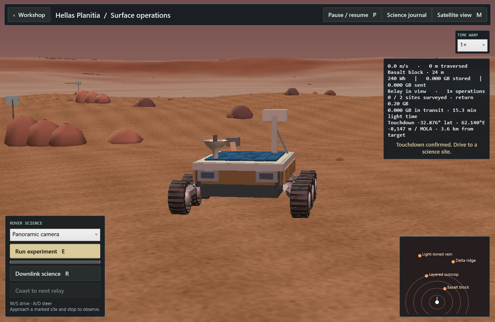

# Perilune

Perilune is a Windows desktop game about designing, flying, and operating space missions. The showcase mission, **Hellas Survey**, takes a rover from a rocket assembly bay on Earth to the floor of Hellas Planitia on Mars. The game also includes 15 Earth and lunar missions and a Sandbox mode for custom mission planning.

[Download the project demo (PowerPoint)](https://github.com/denprorovner-create/spaceappschallange123123/raw/main/docs/Perilune%20-%20Project%20Demonstration.pptx)



## Play the Hackathon demo

1. Download `Perilune-Windows.zip` from this repository's Releases page. Extract the archive and run `Perilune.exe` with the `assets` folder beside it.
2. Select **Choose Mission → Hellas Survey → Auto orbital trajectory**. Use the **Rocket** and **Rover** tabs to inspect or edit the stock craft.
3. Select **Launch from Earth**, then **Launch** on the pad. Follow the computed transfer on the navigation map. At Mars, choose **Take entry control**. Landing assist starts enabled in Auto mode.
4. After landing, press **M** for the Viking orbital mosaic. Select **Traverse map** to set a waypoint, or drive in 3D with **W/A/S/D**.
5. Take panoramic observations at two sites with **E** and start the radio with **R**. Use time warp and **Coast to next relay** to return at least **0.20 GB** to Earth.

See the [player guide](Read%20me.txt) for manual flight controls and the other missions.

## Build and verify

Build on 64-bit Windows with PowerShell and the .NET Framework compiler and WPF assemblies. The game runs offline with the supplied data.

```powershell
.\Build.ps1
$run = Start-Process -FilePath .\Perilune.exe -ArgumentList '--verify' -Wait -PassThru
Get-Content .\verification-results.txt
$run.ExitCode
```

The verification suite exercises the 15 original Earth and lunar scenarios through science return. It also exercises the Hellas mission from launch, through N-body transfer and atmospheric landing, to a two-site rover survey and delayed radio delivery.

## NASA data

Hellas imagery comes from NASA Mars Trek's Viking mosaic and the JPL/USGS global Viking texture. Mars Global Surveyor's MOLA laser-altimeter data supplies regional terrain elevations. JPL Horizons supplies the starting position and velocity vectors for the solar system simulation. Rover-scale rocks, local relief, instruments and field experiments are simulated. Product identifiers, coordinates, attribution and model assumptions are in [MarsDataSources.md](MarsDataSources.md).

Read the [challenge submission](PROJECT-SUBMISSION.md) for the project details and summary.
